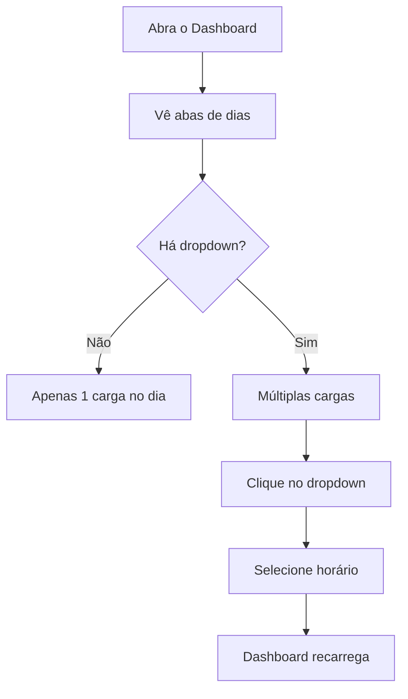

# Guia de Uso: Granularidade por Carga

## 📌 Nova Funcionalidade

A visualização do dashboard agora suporta **múltiplas cargas por dia**.

### Antes
```
Abas:  [19/10]  [18/10]  [17/10]
       ↓
       Mostra apenas a extração mais recente do dia
```

### Depois
```
Abas:  [19/10] [dropdown]  [18/10] [dropdown]  [17/10]
       ↓
       Ao clicar em um dia, você vê a carga mais recente
       Se houver múltiplas, use o dropdown para alternar
```

## 🎯 Como Usar

### Alternando entre Dias
1. Clique em uma aba de dia (ex: "19/10/2026")
2. O dashboard carrega com a **carga mais recente** daquele dia

### Alternando entre Cargas (Horários)
1. Ao lado da aba do dia, aparece um **dropdown** (se houver múltiplas cargas)
2. Clique no dropdown e selecione outra hora
3. O dashboard recarrega com a nova carga

### Navegação por Teclado
- **←/→ Arrow Keys**: Alternar entre dias
- **Home/End**: Ir para primeiro/último dia
- **Tab**: Navegar entre elementos
- **Enter/Space**: Ativar aba ou acessar dropdown

## 📊 Exemplo Prático

Se o seu servidor tem dados assim:

```
19/10/2026, 14:00 → [3.500 seções]
19/10/2026, 12:00 → [3.450 seções]
19/10/2026, 10:00 → [3.400 seções]

18/10/2026, 09:00 → [3.350 seções]
```

Você verá:

```
[19/10/2026] [▼ 14:00]  [18/10/2026]

Na aba "19/10/2026", o dropdown mostra:
  • 14:00 (mais recente) ← selecionado por padrão
  • 12:00
  • 10:00

Na aba "18/10/2026", não há dropdown (só 1 carga)
```

## 🔄 Fluxo de Uso



## 🎨 Visual

```
┌─────────────────────────────────────────────────────┐
│ 19/10/2026  [14:00 ▼]  18/10/2026  17/10/2026      │
└─────────────────────────────────────────────────────┘
│ Seções que mudaram de local no 2º turno             │
│ ..................                                   │
│ [Mapa, gráficos, tabelas...]                        │
└─────────────────────────────────────────────────────┘
```

## 💡 Dicas

1. **Rótulo de extração**: Quando há múltiplas cargas, o dashboard mostra:
   - "19/10/2026 - 14:00" (data + horário)
   
   Quando há 1 carga:
   - "19/10/2026" (só a data)

2. **Cargas ordenadas**: O dropdown mostra as cargas mais recentes primeiro
   - 14:00 (mais nova)
   - 12:00
   - 10:00 (mais antiga)

3. **Comparação**: Use o dropdown para comparar como os dados mudaram ao longo do dia:
   - Veja 3.500 seções às 14:00
   - Selecione 10:00 para ver 3.400 seções
   - Veja a diferença!

## 🔧 Técnico

- Dropdowns aparecem **automaticamente** se houver múltiplas cargas
- A **primeira carga** (mais recente) é selecionada por padrão
- O rótulo de extração no dashboard reflete a carga selecionada
- Navegação por teclado é totalmente funcional

## 📞 Suporte

Se o dropdown não aparecer, pode ser:
- ✓ Você tem apenas 1 carga naquele dia (comportamento normal)
- ✓ Os dados não têm múltiplas extrações
- ✓ Algo deu errado no carregamento

## 🎓 Estrutura de Dados Interna

```js
// Cada dia tem um array de cargas
{
  key: "2026-10-19",
  label: "19/10/2026",
  loads: [
    { extractedAt: "2026-10-19T14:00:00Z", data: {...} },
    { extractedAt: "2026-10-19T12:00:00Z", data: {...} },
    { extractedAt: "2026-10-19T10:00:00Z", data: {...} },
  ]
}
```

Quando você seleciona um item no dropdown, a função `activate(day, loadIndex)` é chamada com o índice da carga desejada.

## 🚀 Pronto!

Agora você pode ver **como os dados mudaram ao longo do dia** sem perder a visão geral de todos os dias.
